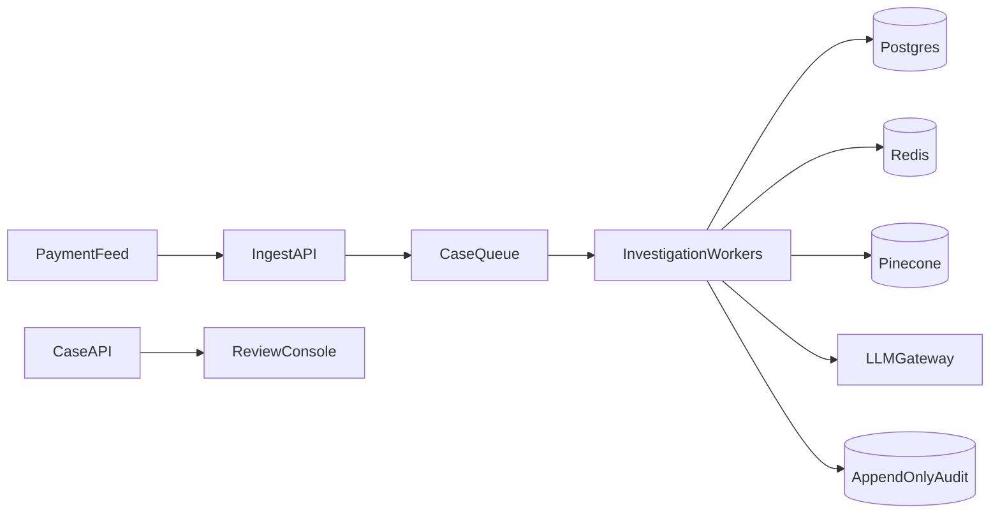

# Architecture — Agentic AML Platform

**MVP now** is the synchronous pipeline this repository runs. **Enterprise target** is the topology a bank deployment must meet. Target adapters and the queue are specified below and are not current code.

## High-Level
The agent sequence is the same in both states. In the MVP, `run_investigation` in `backend/app/orchestration/graph.py` runs this sequence inside the API request. In the enterprise target, investigation workers run that same function.

```
[Transaction Feed / KYC Docs] -> Ingestion Agent (OCR + LLM Extraction) -> Entity Graph (Supabase + Graph Layer)
                                          |
                                          v
                      Pattern/Anomaly (Rules + ML Hybrid) <--> Memory (Pinecone + Supabase)
                                          |
                                          v
                      Sanctions/Watchlist Checker (OFAC, UN via MCP)
                                          |
                                          v
                      Investigation Summarizer -> Report Generator (SAR draft) -> Escalation Router -> Human UI
```

## Components
- **Orchestration**: LangGraph-inspired `AgentGraph` in `backend/app/orchestration/graph.py` — shared state `CaseState` with memory/context. The entry point is `run_investigation`.
- **Document Intelligence (MVP now)**: Tesseract OCR plus LLM extraction (`gpt-4o-mini` when `OPENAI_API_KEY` is set). **Enterprise target adapter**: Azure Document Intelligence. That adapter is not in the current code.
- **Entity Resolution**: Deterministic matching plus embedding similarity (Pinecone), graph linking via NetworkX persisted in Supabase. Offline fallback is local JSON and FAISS.
- **Anomaly Detection (MVP now)**: Rules engine (YAML) plus IsolationForest. **Enterprise target adapter**: LSTM for sequence anomalies. That model is not in the current code.
- **Sanctions Checker (MVP now)**: `sanctions_lookup` reads the OFAC SDN mock CSV, which also carries UN program names. **Enterprise target adapter**: live Dow Jones. That adapter is not in the current code.
- **Case Management UI**: Human-in-the-loop interface with approval/reject/feedback. Feedback writes to the feedback table and the Optimization Agent.
- **Immutable Audit Log**: Append-only audit records plus a hash chain (`backend/app/tools/audit.py`).
- **Memory Layers**:
  - Short-term: Redis with a 1-hour TTL, fallback InMemory
  - Long-term: Supabase Postgres (cases, entities, transactions), fallback JSON in `data/local_db`
  - Semantic: Pinecone (case embeddings for similar case retrieval), fallback local FAISS
  - Episodic: `agent_traces`

## Data Flow
**MVP now.** The API accepts a batch and finishes the investigation before it responds.

1. Ingest transaction JSON / CSV / KYC image
2. Entity Resolution links to Customer, Account, Counterparty
3. Pattern Agent scores risk 0-100
4. Sanctions Agent adds watchlist hits
5. If risk > threshold, Summarizer creates narrative + evidence graph
6. Report Generator creates SAR-style draft when at least two evidence items support it
7. Escalation Router decides: auto-close / escalate / SAR filing

**Enterprise target.** Ingest returns as soon as the idempotency key is recorded. Workers then run steps 2–7 from the queue.

## Deployment

### MVP now
`docker-compose.yml` is the local development stack: FastAPI, Next.js, Postgres, and Redis. Pinecone is optional through `PINECONE_API_KEY` and is not a Compose service. The API process calls `run_investigation` directly, so ingest and investigation share one process. MCP tools under `mcp_servers/` run as local stdio servers. When Supabase or Pinecone credentials are unset, the process uses JSON files in `data/local_db` and FAISS under `data/vector_store`.

### Enterprise target
API and workers are separate stateless processes. `run_investigation` in `backend/app/orchestration/graph.py` stays the worker function.



- Postgres is the system of record. Object storage holds KYC bytes. Redis is only the 1-hour working cache. Pinecone namespaces are per tenant. Local JSON and FAISS remain the offline dev fallback.
- MCP tools stay the same functions. Workers call them as internal services. Stdio servers remain the local development path in `mcp_servers/`.
- The Compose file remains the local development stack. The diagram above is the production topology.

## Security

### MVP now
- PII minimization is implemented in `backend/app/tools/pii_masker.py`. Logs and public case views mask SSN, account numbers, and similar identifiers unless the role is officer or admin.
- The audit log is an append-only hash chain. `GET /audit/verify` checks it.
- Every scored case carries reason codes.
- The API reads the client `X-Role` header in `backend/app/main.py`. CORS allows every origin (`allow_origins=["*"]`).

### Enterprise target
- Identity comes from the bank identity provider. Authorization is enforced on the server for analyst, investigator, officer, and admin.
- Every case, prompt, and threshold query is filtered by tenant.
- CORS allows only the review console origin.
- Secrets are loaded from a secret manager.
- Postgres and object storage encrypt data at rest.
- Health reports queue lag. A scheduled job verifies the audit hash chain.
